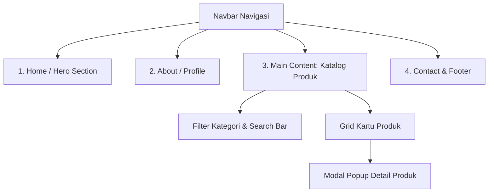

# 📋 Rencana Pengerjaan: Website Katalog Produk (Catalyst Final Assignment)

Dokumen ini berisi perencanaan menyeluruh, jelas, dan mudah dipahami untuk membangun **Website Katalog Produk** statis menggunakan **HTML, CSS, dan Vanilla JavaScript**, sesuai dengan ketentuan pada [Catalyst for Maba - Final Assignment.pdf](file:///c:/Users/Fiy/Desktop/Set%20of%20Projects/Project%20Catalyst/Catalyst%20for%20Maba%20-%20Final%20Assignment.pdf).

---

## 1. Konsep & Pilihan Tema Project

Website katalog produk dirancang untuk menampilkan produk atau layanan sebuah bisnis secara menarik, modern, dan interaktif tanpa memerlukan database atau server backend.

### Rekomendasi Tema (Bisa Dipilih Salah Satu):
*   **Opsi A (Rekomendasi Utama): *Artisanal Coffee & Roastery* (Katalog Kopi & Kafe)**
    *   *Kenapa cocok:* Visual estetik, kategori produk mudah dibagi (Biji Kopi, Minuman Signature, Cemilan/Pastry, Merchandise).
*   **Opsi B: *Minimalist Tech & Workspace Accessories***
    *   *Kenapa cocok:* Tampilan rapi, modern, kategori jelas (Keyboards, Desk Mats, Audio, Cables).
*   **Opsi C: *Local Apparel & Streetwear Brand***
    *   *Kenapa cocok:* Desain stylish, kategori simpel (T-Shirts, Outerwear, Caps, Tote Bags).

> [!NOTE]
> *Contoh dalam rencana ini mengacu pada **Katalog Kopi & Roastery ("Catalyst Coffee Roasters")**, namun strukturnya fleksibel dan dapat dengan mudah disesuaikan ke tema bisnis apa pun.*

---

## 2. Struktur File & Arsitektur

Struktur folder disesuaikan dengan folder yang sudah ada di workspace saat ini:

```text
Project Catalyst/
├── index.html / main.html    # Struktur halaman utama (Single Page Application dengan 4 section)
├── CSS/
│   └── style.css            # Styling visual, layout responsif, tema warna, animasi
├── JavaScript/
│   ├── data.js              # Menyimpan array data produk (tanpa database backend)
│   └── main.js              # Logika rendering katalog, filter kategori, search bar, & modal detail
├── assets/                  # (Opsional) Folder gambar produk & icon
│   └── images/
├── README.md                # Dokumentasi wajib tugas Catalyst
└── Command.txt              # Catatan instruksi
```

---

## 3. Rincian 4 Section Wajib

Website akan menggunakan format **Single-Page** dengan navigasi halus (*smooth scrolling*) antarseksi:



### 1. Home / Hero Section (`#home`)
*   **Navbar Sticky**: Logo/nama brand, tautan menu navigasi (`Home`, `Tentang`, `Katalog`, `Kontak`), dan tombol cepat (CTA).
*   **Hero Banner**:
    *   Headline menarik (contoh: *"Biji Kopi Pilihan Terbaik dari Petani Lokal"*).
    *   Subheadline/deskripsi singkat tentang keunikan produk.
    *   Tombol CTA (Call to Action): *"Jelajahi Katalog"* (langsung scroll ke Section 3) & *"Tentang Kami"*.
    *   Ilustrasi banner / visual produk unggulan.

### 2. About / Profile Section (`#about`)
*   **Profil Bisnis**: Cerita singkat pendirian, filosofi, dan komitmen kualitas produk.
*   **Value / Keunggulan (3-4 Card Sorotan)**:
    *   🌱 *100% Organik & Berkualitas*: Bahan pilihan terbaik.
    *   ⚡ *Pengiriman Cepat*: Pesanan diproses di hari yang sama.
    *   🤝 *Dukungan Petani Lokal*: Menjunjung prinsip fair-trade.
    *   ⭐ *Garansi Kepuasan*: Jaminan kualitas pada setiap kemasan.

### 3. Main Content: Katalog Produk (`#products`)
*Bagian inti website yang menjawab tema project:*
*   **Toolbar Interaktif**:
    *   **Search Bar**: Input pencarian real-time untuk mencari nama produk.
    *   **Filter Kategori**: Tombol kategori (misal: `Semua`, `Biji Kopi`, `Cold Brew`, `Merchandise`).
*   **Product Grid**:
    *   Kartu produk menampilkan: Foto produk, Tag/Badge (misal: "Best Seller", "New"), Nama produk, Kategori, Harga (format Rupiah), serta tombol *"Lihat Detail"*.
*   **Modal Popup (Detail Produk)**:
    *   Ketika pengguna mengklik kartu produk, muncul pop-up sederhana tanpa reload halaman, menampilkan informasi lengkap produk (deskripsi panjang, rasa/karakteristik, berat bersih, tombol *"Pesan via WhatsApp"*).

### 4. Contact & Footer Section (`#contact`)
*   **Kontak & Lokasi**:
    *   Alamat outlet/toko fisik.
    *   Jam operasional (Senin – Minggu).
    *   Tautan WhatsApp direct link untuk pemesanan (`https://wa.me/...`).
    *   Email layanan pelanggan & sosial media (Instagram, TikTok).
*   **Footer**:
    *   Tautan navigasi cepat kembali ke atas.
    *   Copyright & identitas tim Catalyst (`© 2026 Tim Catalyst. All Rights Reserved.`).

---

## 4. Konsep Teknis (Sesuai Batasan: Statis & Tanpa Backend)

Karena **tidak menggunakan backend/database**, data produk dikelola secara cerdas menggunakan array JavaScript di [`JavaScript/data.js`](file:///c:/Users/Fiy/Desktop/Set%20of%20Projects/Project%20Catalyst/JavaScript/data.js):

```javascript
// Contoh struktur data produk di data.js
const productsData = [
  {
    id: 1,
    name: "Gayo Honey Process",
    category: "coffee",
    price: 85000,
    badge: "Best Seller",
    image: "https://images.unsplash.com/photo-1559056199-641a0ac8b55e?w=500",
    shortDesc: "Kopi arabika dengan aroma buah manis dan aftertaste lembut.",
    fullDesc: "Dipetik dari dataran tinggi Aceh Gayo pada ketinggian 1.500 mdpl...",
    weight: "250g"
  },
  // Produk lainnya...
];
```

**Fungsi [`JavaScript/main.js`](file:///c:/Users/Fiy/Desktop/Set%20of%20Projects/Project%20Catalyst/JavaScript/main.js)**:
1.  **Render Dinamis**: Membaca `productsData` dan membuat elemen HTML kartu produk ke dalam grid.
2.  **Filter Kategori**: Menyaring produk sesuai tombol kategori yang diklik.
3.  **Live Search**: Menyaring produk sesuai ketikan pengguna di kotak pencarian.
4.  **Modal Pop-up**: Menampilkan modal detail saat tombol *"Lihat Detail"* diklik dan menutup saat tombol *close* diklik.
5.  **Smooth Scroll**: Memastikan tautan navbar mengarahkan ke bagian yang dituju dengan mulus.

---

## 5. Rencana Pembagian Tugas & Workflow GitHub (3-4 Anggota)

Sesuai instruksi pada PDF Final Assignment (hal. 2-3), proyek wajib mengimplementasikan **GitHub Issues, Branch, Pull Request (PR), dan Review**:

### Rekomendasi Pembagian Task (GitHub Issues):
| No | Judul Issue | Rekomendasi Branch | Deskripsi Pekerjaan |
|---|---|---|---|
| **#1** | Setup Desain & Navigasi Hero | `feature/hero-navbar` | Membuat struktur HTML dasar, Navbar responsif, dan Hero Section + tombol CTA |
| **#2** | Halaman About / Profil Bisnis | `feature/about-section` | Membuat Section About, deskripsi bisnis, visi-misi, serta kartu keunggulan |
| **#3** | Struktur Katalog & Data Produk | `feature/catalog-data` | Membuat file `data.js`, struktur grid produk di HTML, dan styling kartu produk di CSS |
| **#4** | Logika Interaktif Katalog (Filter, Search, Modal) | `feature/catalog-logic` | Menulis fungsi filter kategori, live search, dan modal popup di `main.js` |
| **#5** | Section Kontak & Footer | `feature/contact-footer` | Membuat layout kontak, tautan media sosial, jam buka, dan footer |
| **#6** | Dokumentasi & README | `feature/documentation` | Melengkapi file `README.md` sesuai format deliverables Catalyst dan menambahkan screenshot |

### Aturan Kolaborasi GitHub:
1.  **Branching**: Setiap anggota membuat branch sendiri dari branch utama (`git checkout -b feature/nama-fitur`).
2.  **Commit**: Buat pesan commit yang jelas (contoh: `git commit -m "feat: add product card styling and grid layout"`).
3.  **Pull Request & Review**: Ajukan PR ke branch utama, minta minimal 1 anggota lain mereview dan menyetujui (*Approve*) sebelum di-*merge*.

---

## 6. Tahapan Eksekusi Pengerjaan

- [ ] **Fase 1: Fondasi & Setup Awal**
  - Buat kerangka dasar di `index.html` (atau tautkan `main.html` sebagai titik masuk).
  - Siapkan warna tema, tipografi (Google Font), dan CSS reset di [`CSS/style.css`](file:///c:/Users/Fiy/Desktop/Set%20of%20Projects/Project%20Catalyst/CSS/style.css).
- [ ] **Fase 2: Implementasi Hero & About Section**
  - Buat Navbar sticky dengan navigasi anchor (`#home`, `#about`, `#products`, `#contact`).
  - Selesaikan Hero Section dengan pesan selamat datang dan CTA.
  - Selesaikan About Section dengan cerita brand dan keunggulan.
- [ ] **Fase 3: Implementasi Katalog Produk Dinamis**
  - Isi data dummy produk (6-8 produk) di [`JavaScript/data.js`](file:///c:/Users/Fiy/Desktop/Set%20of%20Projects/Project%20Catalyst/JavaScript/data.js).
  - Tulis fungsi render otomatis kartu produk ke dalam grid di [`JavaScript/main.js`](file:///c:/Users/Fiy/Desktop/Set%20of%20Projects/Project%20Catalyst/JavaScript/main.js).
  - Tambahkan fitur filter kategori dan live search bar.
  - Buat modal popup untuk detail produk.
- [ ] **Fase 4: Implementasi Kontak & Footer**
  - Susun info kontak, WhatsApp button, jam buka, dan social links.
  - Buat footer informatif dengan hak cipta.
- [ ] **Fase 5: Uji Coba Responsif & Dokumentasi Deliverables**
  - Uji tampilan di layar desktop dan smartphone (responsif).
  - Simpan screenshot website ke folder `screenshots/`.
  - Lengkapi [`README.md`](file:///c:/Users/Fiy/Desktop/Set%20of%20Projects/Project%20Catalyst/README.md) sesuai ketentuan halaman 3 PDF (nama anggota, deskripsi, cara menjalankan lokal, pembagian tugas).

---

## 7. Deliverables Checklist (Syarat Pengumpulan Catalyst)

Sebelum deadline (Jumat, 30 Oktober 2026), pastikan item berikut lengkap:
* [ ] Website statis berjalan lancar secara lokal (cukup buka via browser / Live Server).
* [ ] 4 Section utama lengkap dan navigasi berfungsi.
* [ ] Terdapat 4–8 GitHub Issues yang tercatat.
* [ ] Setiap anggota memiliki branch, commit, dan minimal 1 Pull Request yang telah di-review.
* [ ] File [`README.md`](file:///c:/Users/Fiy/Desktop/Set%20of%20Projects/Project%20Catalyst/README.md) terisi lengkap sesuai format Catalyst.
* [ ] Screenshot tampilan website tersimpan di repository.
